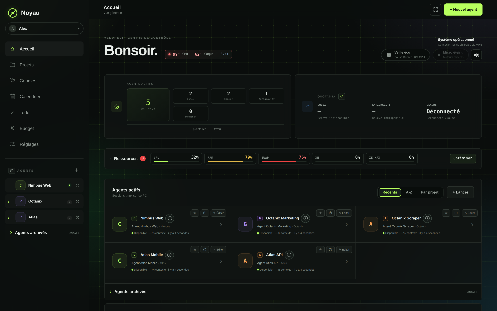
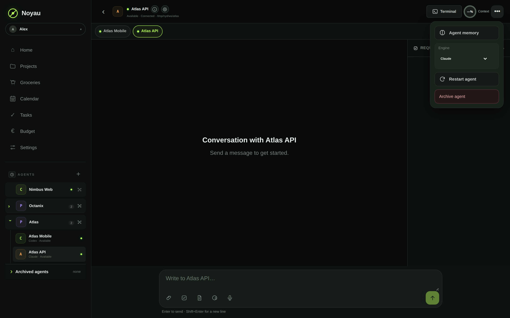
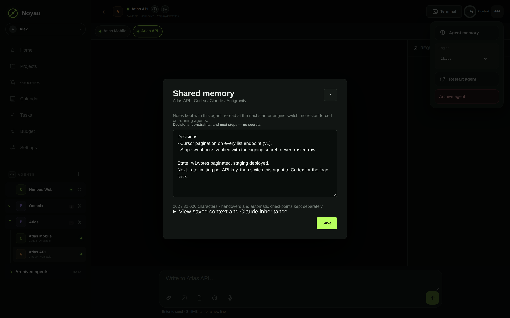
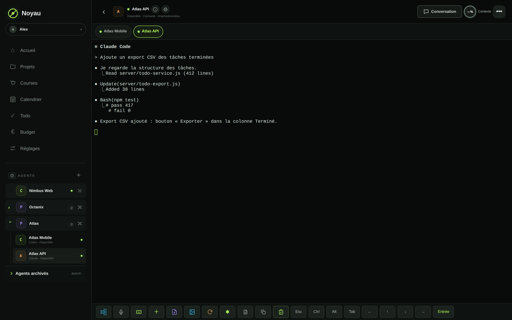
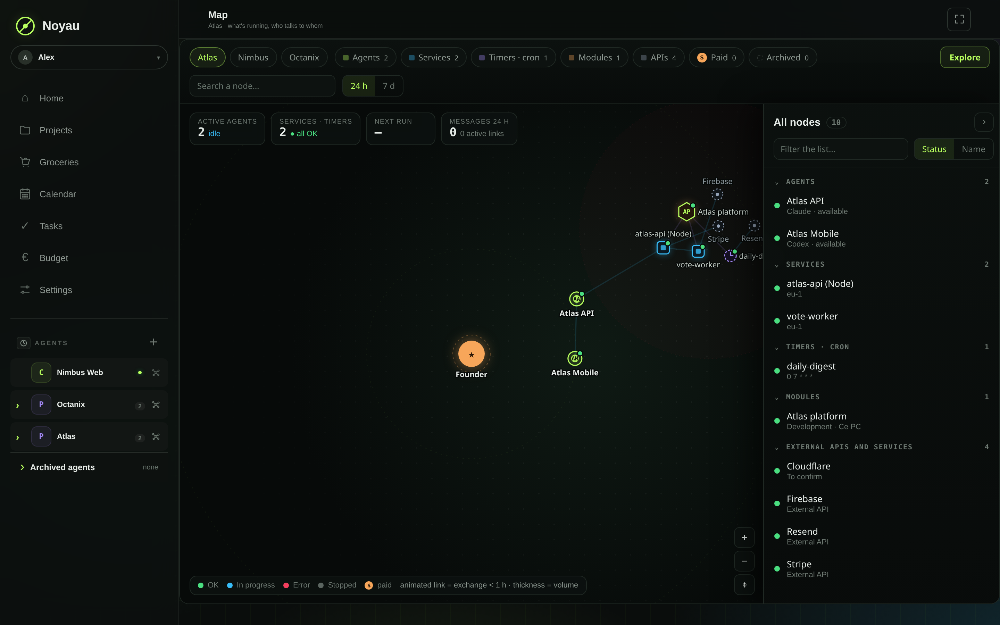
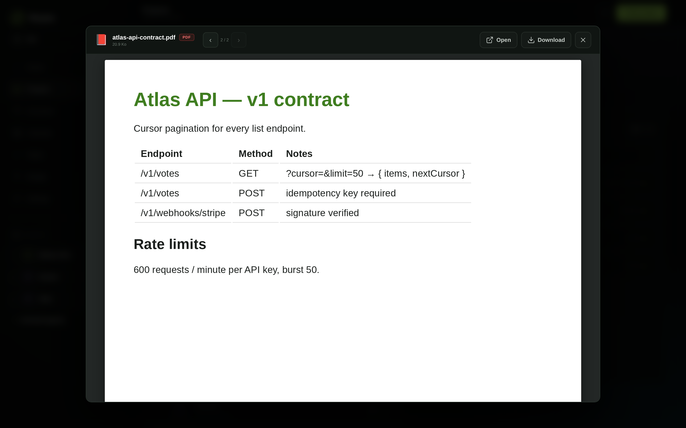
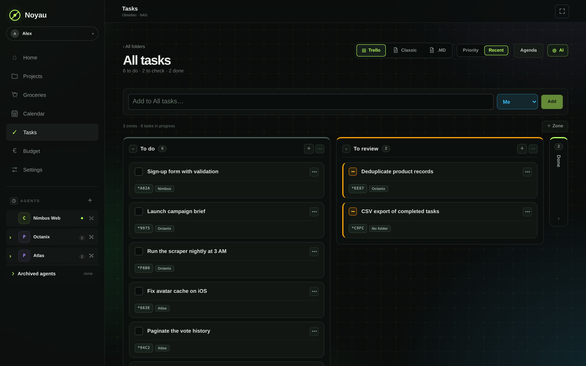
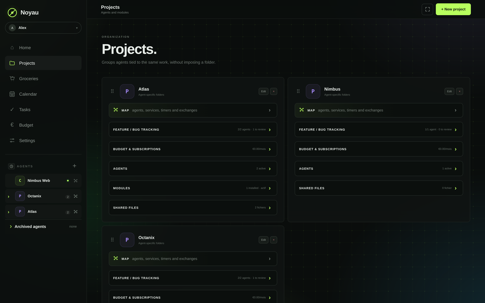
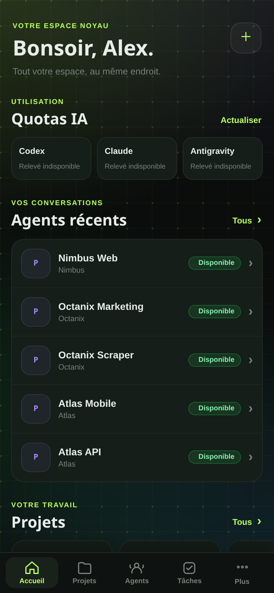

# Noyau

Local control center for CLI coding agents. Noyau runs Codex, Claude Code and Antigravity in persistent `tmux` sessions, exposes them in a web UI that works with a keyboard or a touchscreen, and keeps the work tracking (tasks, projects, budget) in the same place.

Everything runs on your machine: no third-party service, no database, plain files and an Obsidian vault.



## Features

### One agent, any engine

Each agent is a persistent `tmux` session: it survives a closed tab, a server restart or a dropped connection. Switch it from Claude Code to Codex or Antigravity (and back) without losing the thread: the pane is respawned in place, the agent keeps its identity, aliases and project, and the new engine starts with the handover and the shared memory.



### Persistent multi-agent memory

Every agent owns a memory that is independent of the engine: durable notes (decisions, constraints, next steps), automatic handovers and checkpoints. It is injected at start-up and after every switch, and agents write to it themselves before their context changes (`node scripts/noyau-agent.mjs memory <id> note "…"`).



### Agents that talk to each other

Agents list each other, read each other's context and hand over work from their own terminal. Messages are queued while you are typing, so an agent never overwrites your draft.

```bash
node scripts/noyau-agent.mjs list                          # running agents, project, state
node scripts/noyau-agent.mjs send "Atlas Mobile" "API ready on staging"
node scripts/noyau-agent.mjs read "Atlas API"              # context of another agent
node scripts/noyau-agent.mjs create --name "Load tests" --prompt "…"
```




### Autonomous agents

Tick "Autonomous agent" when creating a Claude or Codex agent, on a project or with no directory to pick. A deterministic loop, with no LLM and no tokens spent, watches the project's modules, services, timers and crons, or the systemd units you attach to it. On a lasting failure it wakes the agent with an `Incident` message, shown apart from your own messages.

- Keeps the agent alive, resuming its conversation after a crash
- Bounded wake-ups: 4 per hour, retries from 30 minutes to 6 hours, held back while the quota is exhausted
- Intelligence slider, changeable at any time: model on Claude, reasoning effort on Codex
- Pause at any time
- Pessimistic weekly usage estimate per engine, measured from the transcripts, or "not enough data" until there is enough to measure

An autonomous agent with full permissions acts on production on its own: enable it where that is what you want.

### Delegate and restart without losing work

The robot button in the composer hands a request to a new dedicated agent: the current agent creates it, briefs it with the relevant context and reads its report. When a context is full, "restart" starts a clean context that carries over the requests, open tasks, uncommitted files and interrupted subagents, then resumes the work, with a marker in the conversation.

### Project map

Who runs what, and who talks to whom: agents, systemd services and timers, cron jobs, modules and the external APIs found in the code (`.env` key names, SDKs, hosts — never values). Nodes and links can also be declared in a module manifest (`.noyau/modules/*.json`, `map` key).



### Shared files

Each project has a shared folder where agents drop deliverables (`node scripts/noyau-file.mjs put build.apk`). When an agent mentions a file, the chat shows a one-click preview card; images, PDF (rendered with pdf.js, works on mobile), audio, video, CSV, JSON and Markdown open in place.



### Chat or terminal

A conversation view sits on top of the raw xterm.js terminal: chat bubbles, live activity, a summary of your requests with jump-to-message, Enter to send. The terminal keeps a key bar built for touch (Ctrl, Alt, Esc, paste, upload, screen capture). Quotas for Codex, Claude and Antigravity are polled and shown; notifications fire when an agent finishes.

### Tasks with automatic tracking

A Trello-style board stored as hand-editable Markdown in an Obsidian vault (`- [ ] text 📅 2026-09-12 <!-- noyau:{…} -->`), with short `*A1B2` references clickable inside a terminal. A `UserPromptSubmit` hook (Claude Code and Codex) gives the agent the open tasks of the project: it creates or comments the task, then moves it to "to review" with the commit — never to "done", that stays your call.



### Optional modules

Projects, Tasks, Calendar, Groceries (meal planning, basket comparison) and Budget (envelopes, optional bank sync) can each be switched off for the whole instance from Settings, in `.data/features.json`, or with `NOYAU_DISABLED_MODULES=groceries,budget`.

### English and French

The UI ships in English and French (Settings → Language, default from the browser). Strings live in `src/locales/en.json` with the French source text as key; `node scripts/i18n-check.mjs` lists anything untranslated and the test suite fails on it.



## Architecture

```
server/      Express API + WebSocket, one module per domain
  tmux.js            session creation, restore, capture, provider switch
  agent-memory.js    per-agent memory shared across providers
  agent-conversation.js  transcript reading for the chat view
  session-store.js   atomic JSON persistence
  todo-service.js    Markdown vault read/write
  board-service.js   board zones, per-profile settings
  module-service.js  project modules, systemd, device builds
  finance-*.js       budget, banking, advisor
shared/      code shared by server and UI (groceries, alerts)
src/         React UI (single view, no router)
scripts/     tools the agents call (tasks, agent-to-agent, design)
test/        node:test unit tests
```

No server framework beyond Express, no client state manager, no database. Tests run on Node's built-in runner.

## Install

Requires Node 20+, `tmux`, and at least one agent CLI (`codex`, `claude` or `antigravity`).

```bash
npm install
npm run build
NOYAU_TOKEN="a-long-random-key" npm start
```

The UI listens on `http://localhost:4242`. The access key is asked once, then kept in `.data/access-token`.

### Security

Noyau can start shell sessions and control project services, so treat its web UI like SSH access:

- use a long, unique `NOYAU_TOKEN` and never commit `.data/` or TLS private keys;
- bind `HOST` to `127.0.0.1` unless the instance is protected by a trusted VPN or reverse proxy;
- do not expose port `4242` directly to the public internet;
- use the HTTPS listener when accessing Noyau from another device;
- run Noyau as an unprivileged user and review module actions before enabling them.

### Environment

| Variable | Purpose |
| --- | --- |
| `NOYAU_TOKEN` | UI access key (required on first run) |
| `PORT` / `HOST` | HTTP listener (default `4242` / `0.0.0.0`) |
| `NOYAU_HTTPS_HOST` / `NOYAU_HTTPS_PORT` | HTTPS listener for VPN access |
| `NOYAU_TLS_CERT` / `NOYAU_TLS_KEY` / `NOYAU_CA_CERT` | HTTPS certificates |
| `NOYAU_DATA_DIR` | Data directory (default `.data/`) |
| `NOYAU_WORKSPACE_ROOT` | Root of the repositories offered when creating an agent |
| `NOYAU_TODO_FILE` | Markdown file of the Obsidian vault |
| `NOYAU_TODO_MOUNT_URI` | GVFS mount to perform when the vault sits on a NAS |
| `NOYAU_DISABLED_MODULES` | Comma-separated modules hidden by default (`projects,todos,calendar,groceries,budget`) |

`noyau.service` is a user systemd unit to adapt, `desktop/` holds the entries to run the UI fullscreen on a touch machine.

### Phone

The HTTPS listener serves the same UI as an installable PWA: push notifications, touch terminal, install of the iOS/Android builds produced by the modules. The local certificate is at `/noyau-ca.cer`.

A Capacitor shell (`capacitor.config.json`, `scripts/build-mobile.mjs`) packages the UI as a native app: Face ID / fingerprint unlock bound to the OS keystore (see [docs/native-auth.md](docs/native-auth.md)), native notifications when an agent finishes, offline snapshots. The native projects are not part of this repository; generate them with `npx cap add android|ios`.




## Agent commands

```bash
node scripts/noyau-agent.mjs list                      # running agents, project, state
node scripts/noyau-agent.mjs send "Name" "Message"     # hand over a task
node scripts/noyau-todo.mjs list                       # tasks of the current project
node scripts/noyau-todo.mjs add "Text"                 # create a task
node scripts/noyau-todo.mjs report *A1B2 "What changed"
node scripts/noyau-file.mjs put build.apk               # drop a deliverable in the project's shared files
```

`server/todo-track-hook.js` installs as a `UserPromptSubmit` hook in `~/.claude/settings.json` and `~/.codex/hooks.json`.

## Development

```bash
npm run dev     # server with reload
npm test        # full suite (node:test)
npm run build   # production bundle
```

See [CONTRIBUTING.md](CONTRIBUTING.md) for the complete contribution workflow, required checks, and security expectations.

Screenshots come from a demo instance: the agents, projects and tasks shown are fictional.

## License

MIT.
